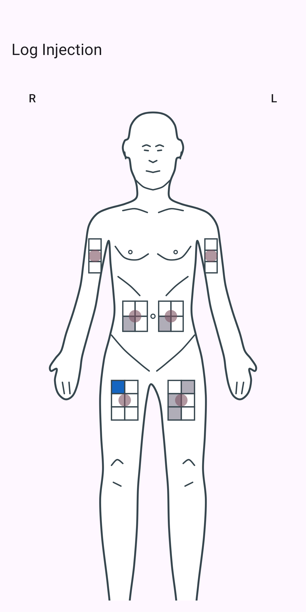
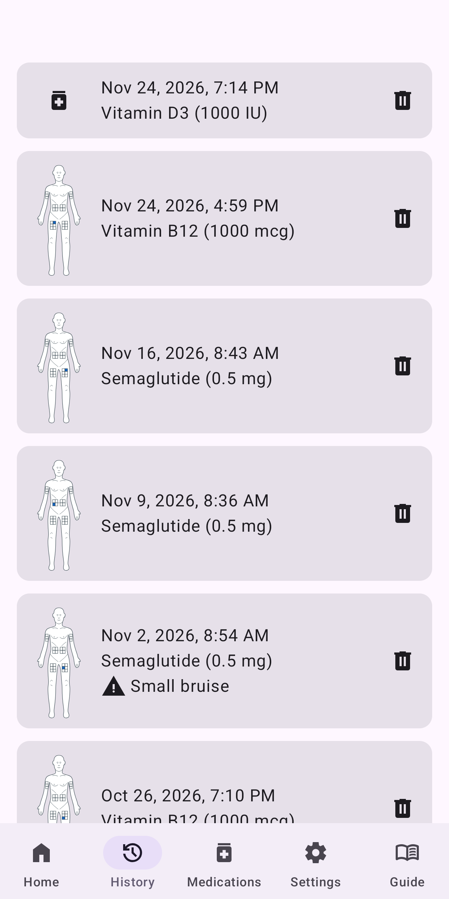
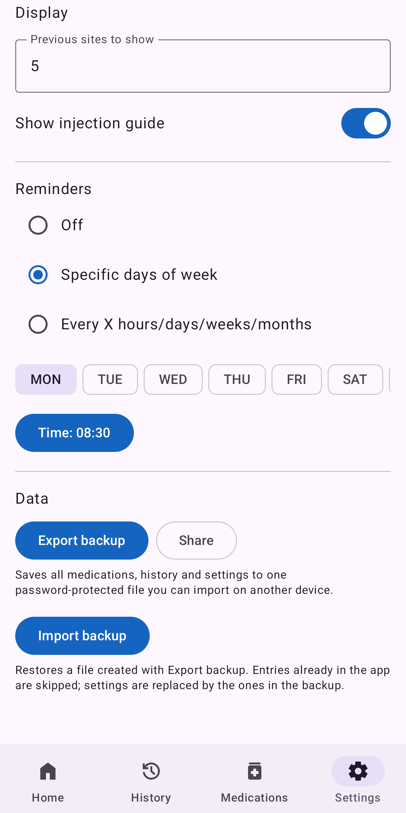
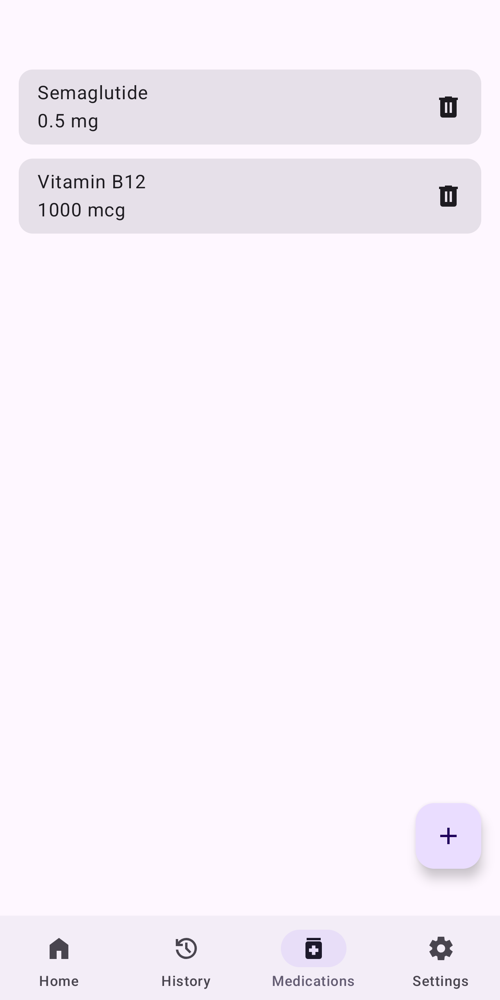
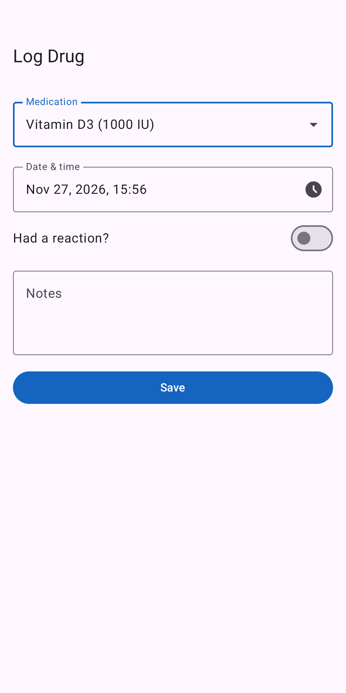

# DoseTrack

A privacy-first Android app for logging self-administered injections: when each dose was taken, where it was injected, and how your body reacted.

All data stays on the device. The app has no internet permission, no account, no analytics and no ads.

## Screenshots

<p>
  <a href="screenshots/1_log_injection.png"></a>
  <a href="screenshots/2_history.png"></a>
  <a href="screenshots/3_reminders.png"></a>
  <a href="screenshots/4_medications.png"></a>
  <a href="screenshots/5_log_details.png"></a>
</p>

Screenshots use fictional sample data.

## Features

- **Injection log.** Tap the site on a body diagram, pick a medication and dose, and record reactions and notes. Note-only entries are supported for days without an injection.
- **Site rotation.** A grid splits the body diagram into injection zones, and previous injection sites are highlighted on it (the count is configurable).
- **Medications.** Save medications with a dose in mg, mL, mcg, IU or units.
- **History.** Browse, edit and delete every entry.
- **Reminders.** Remind on chosen days of the week, or every N hours, days, weeks or months. Reminders are re-armed after a reboot, time change or app update. Lock-screen notifications are discreet.
- **Encrypted backups.** Export to a file or share it, then restore on any device.

## Privacy and security

| Area | How it works |
| --- | --- |
| Network | No `INTERNET` permission, so the app cannot send data anywhere |
| Storage | Room database and DataStore in app-private storage |
| Android backup | Cloud backup is fully excluded. Only direct device-to-device transfer is allowed (`res/xml/data_extraction_rules.xml`, `backup_rules.xml`) |
| Backup files | AES-256-GCM, with the key derived via PBKDF2-HMAC-SHA256 from a user password. The header is bound to the ciphertext as associated data (`export/BackupCrypto.kt`) |
| Notifications | `VISIBILITY_PRIVATE` with a generic public version for the lock screen |

See the full [privacy policy](PRIVACY.md).

## Tech stack

- Kotlin, Jetpack Compose (Material 3), Navigation Compose
- Room (with KSP) for the injection and medication database
- DataStore Preferences for settings
- AlarmManager exact alarms for reminders, with an inexact fallback when the permission is denied
- Manual dependency injection through `AppContainer`, with no DI framework

## Requirements

| Item | Version |
| --- | --- |
| JDK | 17 |
| Gradle | 9.9.2 (wrapper included) |
| Android Gradle Plugin | 9.5.2 |
| compileSdk | 37 (minor API level 2) |
| targetSdk | 36 |
| minSdk | 30 (Android 11) |

Use a recent Android Studio that supports AGP 9.5.

## Building

```bash
# Debug APK
./gradlew :app:assembleDebug

# Install on a connected device or emulator
./gradlew :app:installDebug

# Unit tests
./gradlew :app:testDebugUnitTest

# Lint
./gradlew :app:lintDebug
```

### Release builds

Release builds are signed with credentials read from `~/.gradle/gradle.properties`, which lives outside the repository:

```properties
dosetrack.storeFile=/absolute/path/to/upload.jks
dosetrack.storePassword=...
dosetrack.keyAlias=upload
dosetrack.keyPassword=...
```

Then build the Play Store bundle:

```bash
./gradlew :app:bundleRelease
# Output: app/build/outputs/bundle/release/app-release.aab
```

Never commit keystores. `*.jks` and `*.keystore` are already in `.gitignore`.

## Project structure

```
app/src/main/java/com/dosetrack/
├── data/        Room database, DAOs, entities, domain models, repositories, settings
├── di/          AppContainer: manual dependency wiring
├── export/      Backup export/import, encryption, CSV format, password policy
├── reminders/   Alarm scheduling, notification, boot receiver, next-fire-time calculation
├── ui/          Compose screens and ViewModels (home, log entry, history, medications, settings)
└── util/        Date formatting and permission helpers
```

The Room schema is exported to `app/schemas/` for migration tracking.

## Tests

Unit tests in `app/src/test` cover data validation, backup encryption and format, CSV parsing, backup restore, password policy, reminder time calculation, input validation and injection-site grids.

## License

DoseTrack is free software, licensed under the [GNU General Public License v3.0](LICENSE). You can use, study, modify and share the code. If you distribute a modified version, it must also be released under GPL-3.0, with its source code.

**Name and logo:** under the [additional terms in NOTICE](NOTICE), a modified version must use its own name, its own icon and a different application ID. It must not present itself as the official DoseTrack. Saying "based on DoseTrack" is fine.

The official DoseTrack is, and will stay, free, ad-free and without any data collection.

## Disclaimer

DoseTrack is a personal logging tool, not a medical device. It does not give medical advice or recommend doses. Always follow the instructions of your doctor or pharmacist.
